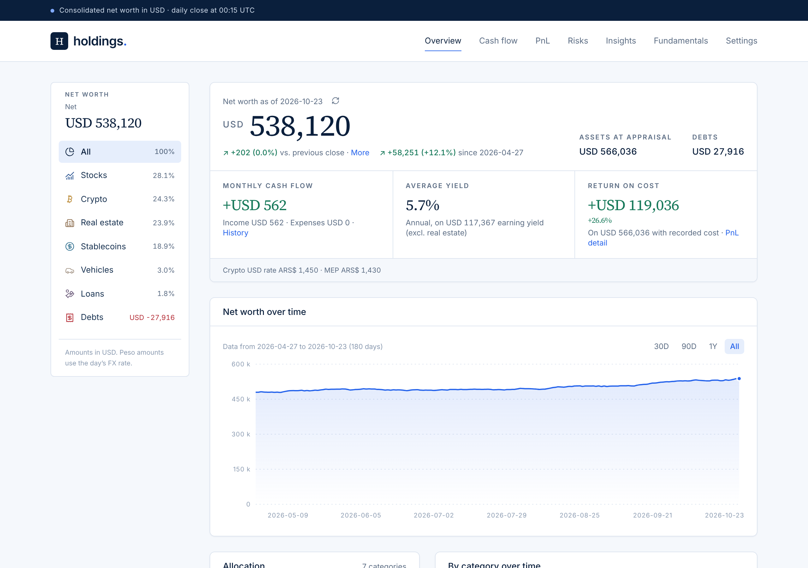
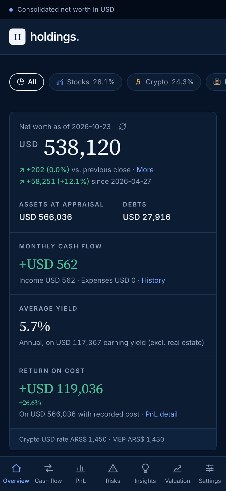
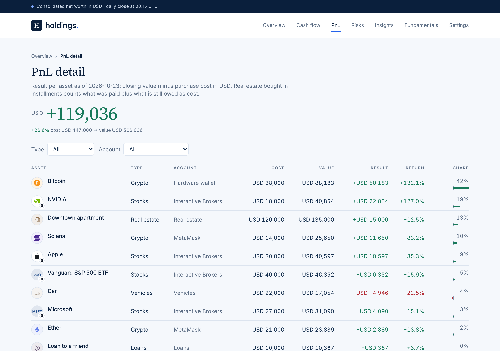

# Holdings

Track your entire portfolio and receive insights and risk alarms on Telegram.

A single-user net worth dashboard: crypto wallets, brokers, real estate, loans and cash, all consolidated in USD with a daily close, charts, PnL and monthly cash flow. Built with Next.js, Postgres (Neon) and Vercel. The UI is in Spanish and the peso conversions are built for Argentina (dólar cripto and MEP).

<p>
  
  
</p>
<p></p>

<sub>Screenshots with dummy data.</sub>

## Features

- **Net worth at a glance**: total, assets minus debts, history chart and a breakdown by category.
- **Automatic sync** of wallets and brokers once a day, with manual assets alongside.
- **PnL** per asset and category, from purchase cost.
- **Monthly cash flow**: yields (APR), coupons, rent and expenses.
- **Daily change**: what moved your net worth today, split into price and quantity (`/variacion`).
- **Risk alarms and insights** written by an AI agent and pushed to Telegram.
- **API** so agents (or scripts) can log trades, installments and appraisals.

## How it works

- Every asset has a quantity (the sum of its movements) and a price source.
- Once a day (`vercel.json`, 00:15 UTC) a cron runs the daily close: it reads the sources, updates quantities and writes one snapshot per asset. Charts and PnL come only from those snapshots.
- If a source fails, its assets keep yesterday's price marked as stale. Nothing is ever written as zero.
- Whatever has no API (real estate, cars, exchanges without integration, cash, loans) is loaded by hand in `/onboarding` or through the API.

Supported sources, all optional: EVM wallets and DeFi (Zerion, with Alchemy as fallback), Bitcoin, NEAR and MultiversX addresses, Invertir Online, Interactive Brokers (Flex Queries) and CoinGecko prices.

## Setup

1. **Fork or clone** this repo and import it in [Vercel](https://vercel.com/new).
2. **Database.** In Vercel, Storage, create or connect a Neon Postgres store with the env prefix `HOLDINGS`. Each build creates the `holdings` database and applies `db/schema.sql`.
3. **Environment variables.** Copy them from `.env.example` into Vercel (Production):
   - `ALLOWED_EMAIL`: your email (the only user).
   - `AUTH_PASSWORD_HASH`: run `pnpm hash-password 'your-password'` and paste the result.
   - `SESSION_SECRET` and `AGENT_API_TOKEN`: random strings (`openssl rand -hex 32`).
   - `APP_URL`: your app URL (used in Telegram links).
   - Only the sources you use: `ZERION_API_KEY`, `ALCHEMY_API_KEY`, `COINGECKO_API_KEY`, `IOL_USERNAME` / `IOL_PASSWORD`, `IBKR_FLEX_TOKEN` / `IBKR_FLEX_QUERY_ID` / `IBKR_FLEX_TRADES_QUERY_ID`.
   - Optional: `GOOGLE_CLIENT_ID` / `GOOGLE_CLIENT_SECRET` for Google login (redirect URI `https://<your-domain>/api/auth/callback/google`), and `TELEGRAM_BOT_TOKEN` / `TELEGRAM_CHAT_ID` for alerts.
4. **Deploy**, log in and open `/onboarding` (Configuración): add your wallets, properties, installment plans and manual assets, then click "Ejecutar el cierre ahora".

Optionally, before the first deploy, fill `db/owner-config.json` with your starting data (see `db/owner-config.example.json`). It is applied once, when the database is empty. If your repo is public, don't commit personal data there: load it from `/onboarding` or the API instead.

### Google login (optional)

Password login works on its own; Google is an extra.

1. In [Google Cloud Console](https://console.cloud.google.com/apis/credentials), create an OAuth client ID of type *Web application*.
2. Add the authorized redirect URI `https://<your-domain>/api/auth/callback/google`.
3. Set `GOOGLE_CLIENT_ID` and `GOOGLE_CLIENT_SECRET` in Vercel and redeploy. The button shows up in `/login`.
4. Only the Google account whose email equals `ALLOWED_EMAIL` can sign in.

### Local development

```bash
pnpm install
cp .env.example .env.local   # fill HOLDINGS_DATABASE_URL and the login variables
node --env-file=.env.local scripts/migrate.mjs
pnpm dev
```

## API

Every call takes `Authorization: Bearer $AGENT_API_TOKEN` and JSON. Assets are referenced by `id` or `key` (both come from `GET /api/v1/holdings`). Dates are `YYYY-MM-DD`. `external_id` is optional and prevents duplicates on retries. A read-only token for agents is shown in `/onboarding`.

| Method and path | What for |
| --- | --- |
| `GET /api/v1/holdings` | Holdings at the last close (`?changes=1` adds the daily change per asset) |
| `POST /api/v1/deltas` | Buys and sells: `{"deltas":[{"asset":"manual:exchange:btc","delta":"0.02","unit_price":"67000"}]}` |
| `POST /api/v1/assets` | New manual asset: `{"account_key":"exchange","symbol":"BTC","name":"BTC on exchange","category":"crypto","price_source":"coingecko","price_ref":"bitcoin","initial_quantity":"0.1"}` |
| `PATCH /api/v1/assets/{id or key}` | Change name, category or meta (e.g. `{"meta":{"apr_manual":0.05}}`) |
| `POST /api/v1/wallets` | New wallet: `{"provider":"zerion","address":"0x...","name":"MetaMask"}` (`zerion`, `btc`, `near`, `mvx`) |
| `POST /api/v1/cash-flows` | Installments, fees, rent: `{"asset":"<key>","kind":"cuota","amount":"1000000","currency":"ARS"}` |
| `POST /api/v1/valuations` | Appraisal: `{"asset":"<key>","value":"130000","currency":"USD"}` |
| `POST /api/v1/events` | Dividend and coupon dates |
| `POST /api/v1/sync` | Run the close now |
| `GET` / `POST /api/v1/alerts` | Read or publish risk and insight alerts |
| `GET /api/v1/owner-config` | Export your manual data in the `db/owner-config.json` format (a backup) |

Categories: `stablecoin`, `crypto`, `acciones`, `cedears`, `bonos_on`, `fci`, `cash`, `real_estate`, `vehiculo`, `prestamos`, `otros`, `deuda`. Price sources: `coingecko` (with `price_ref`), `stable` (worth 1 USD), `manual` (latest appraisal), `invested` (what was paid in), `debt`, `loan`.

## Routines

There are two kinds: the cron jobs that live in this repo, and agentic routines that run outside it and talk to the app through the API.

### In the repo (Vercel Cron)

| Job | When (`vercel.json`) | What it does |
| --- | --- | --- |
| Daily close | `/api/cron/daily`, 00:15 UTC | Reads every source, updates quantities and writes one snapshot per asset. |
| Retry | `/api/cron/daily?retry=1`, 02:30 UTC | Runs again only if there was no close today or a source failed. If it still fails, it alerts on Telegram. |

Vercel calls them with `CRON_SECRET`. The day and the labels in the UI follow Argentina time (`lib/dates.ts`); if you change the schedule in `vercel.json`, update those too. To get Telegram messages, create a bot with [@BotFather](https://t.me/BotFather), send it any message, read your chat id from `https://api.telegram.org/bot<token>/getUpdates`, set `TELEGRAM_BOT_TOKEN` and `TELEGRAM_CHAT_ID`, and test with `POST /api/v1/alerts` and `{"test":true}`.

### Outside the repo (AI agents)

Research and judgment are done by an agent on a schedule, not by the app. Any agent platform that can browse the web and make HTTP calls works. Each routine reads the portfolio, researches, and writes alerts; the app stores them, shows them and sends the new `alta` and `critica` ones to Telegram.

| Routine | Suggested schedule | Reads | Writes |
| --- | --- | --- | --- |
| **Risks**: news, earnings, regulation or platform issues that threaten an asset you hold | Daily | `GET /api/v1/holdings`, `GET /api/v1/alerts?kind=riesgo&status=active` | `POST /api/v1/alerts` with `kind: "riesgo"` |
| **Insights**: rebalancing ideas and buying opportunities | Daily | holdings, active `insight` and `fundamental` alerts | `kind: "insight"` |
| **Fundamentals**: fair value, buy zone and verdict per company you hold or follow | Monthly | holdings | one `kind: "fundamental"` alert per company |
| **Market research digest**: one-page summary of the month's public reports from big banks and asset managers | Monthly | none | one `kind: "fundamental"` alert |
| **Movements from email** (optional): turns exchange or bank notification emails into trades | Daily | your inbox | `POST /api/v1/deltas` with `external_id` |

Rules that keep them working together:

- Each alert has a `dedupe_key`: the same key is ignored while the alert is active, so a routine can run every day without repeating itself.
- Each run first reviews its own active alerts and deprecates the ones that no longer apply (`"deprecate":[{"id":"...","reason":"..."}]` in the same POST).
- Each routine only reads and deprecates its own `kind`.
- Severity (`baja`, `media`, `alta`, `critica`) decides what reaches Telegram, so keep `alta` for things worth acting on.
- Routines that only read can use the read-only token shown in `/onboarding`.

**With Claude.** Create each routine as a scheduled task in [Claude Code on the web](https://claude.ai/code) (or as a recurring task in the Claude app): write the instructions in your own words following the table above, choose the schedule, and give the task your `APP_URL` and token through the environment's secrets, never in the prompt text. Allow network access to your app domain. For the email routine, connect your mail account as a connector.

## License

[Apache 2.0](LICENSE). If you use or redistribute it, keep the [NOTICE](NOTICE) file with the attribution.
